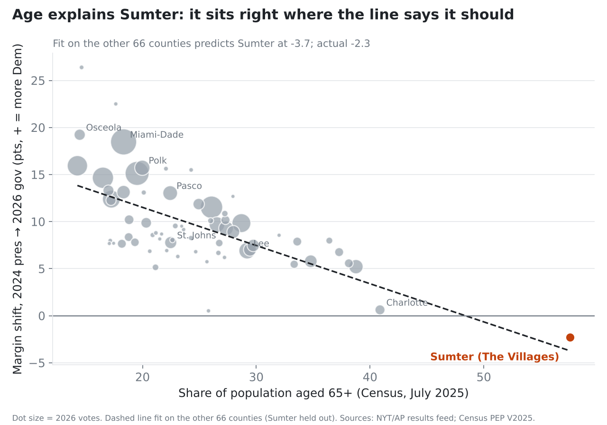
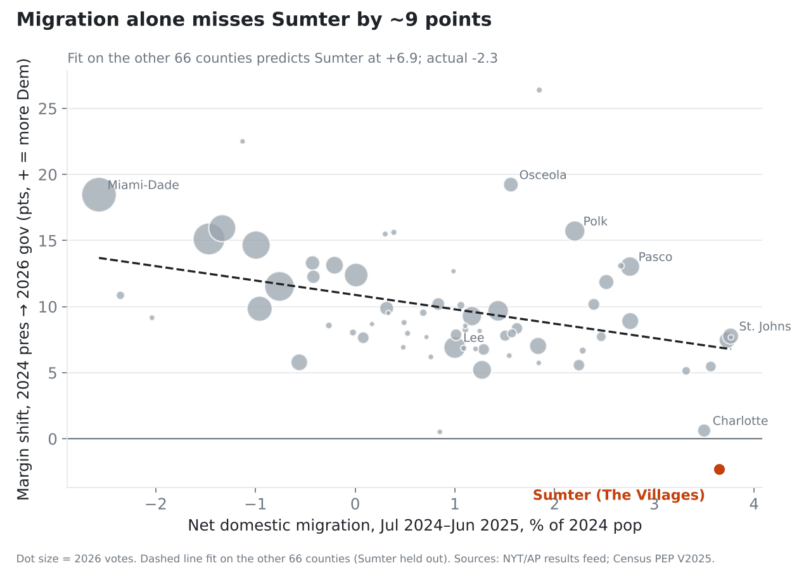
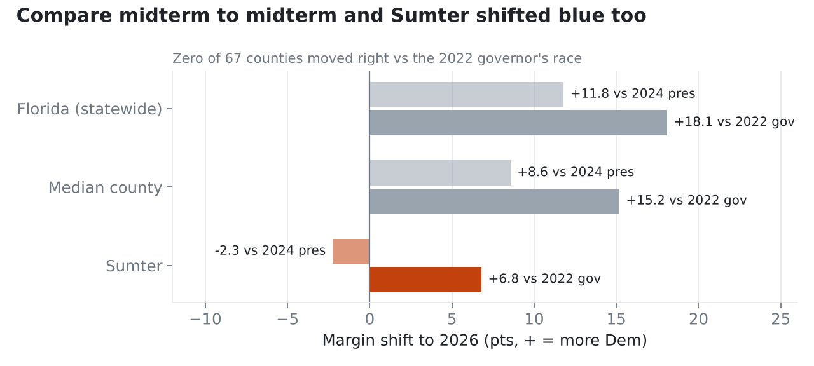
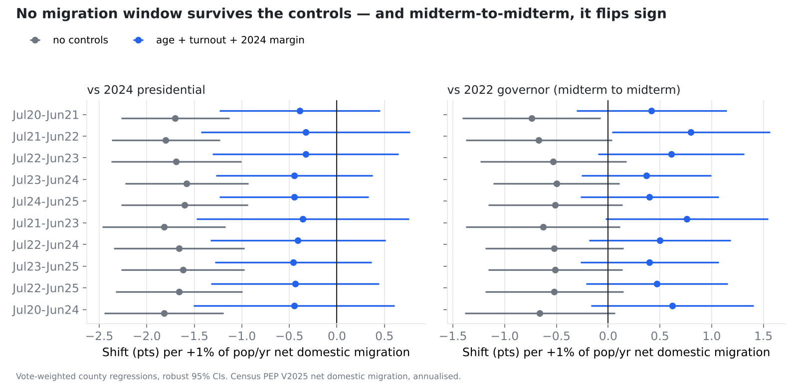
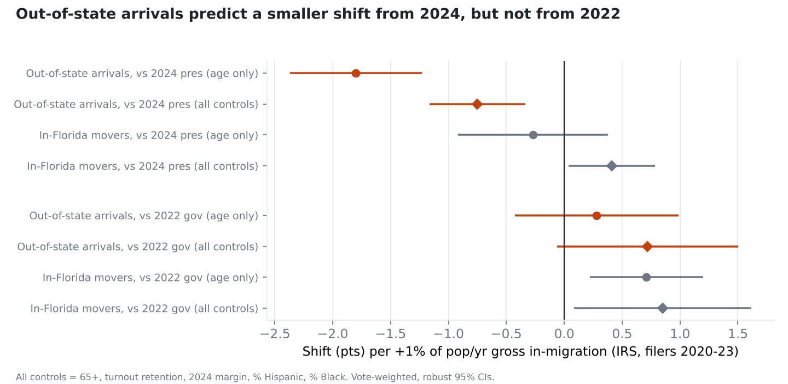

# Did The Villages blunt Florida's blue wave? Mostly no. Age did.

**TL;DR.** On the NYT map, Sumter County (The Villages) was the only Florida county that moved right from 2024 to 2026. The obvious theory is that Republican retirees moving into growth counties held back the blue shift. I tested it against Census migration data. It mostly doesn't hold. **Florida's blue wave was smallest where the electorate was oldest, whether those retirees arrived last year or decades ago.** Hold Sumter out and fit a line through the other 66 counties on age alone: it predicts Sumter's shift almost exactly. Recent migration adds little once you account for age, and it doesn't come close to the 107,721 votes Jolly lost by.

**Round 2** (below) splits migration into moves within Florida and arrivals from other states. Out-of-state arrivals *do* predict a smaller shift from 2024, even with full controls. But those same counties shifted at least as far toward Democrats as everywhere else when you compare 2026 to the 2022 midterm. The pattern is mostly about 2024: those counties never swung as hard toward Trump, so they had less to give back.

Data as of the morning of Nov 4, 2026 (about 99% of the expected vote counted, unofficial). The 2026 race is Donalds (R) vs Jolly (D) for governor.

---

## The setup

| | 2022 gov | 2024 pres | 2026 gov |
|---|---|---|---|
| Florida margin | R+19.4 | R+13.1 | **R+1.3** |
| Sumter margin | R+46.7 | R+37.6 | **R+39.9** |

Statewide, Florida moved **11.8 points toward Democrats** from 2024 and the median county moved 8.6. Sumter moved **2.3 points toward Republicans**, and it was the only county of 67 to do so.

The theory: Sumter is about 0.7% of Florida's population, but it took **25% of Florida's net domestic migration** from July 2024 to June 2025 (5,633 of 22,517 people). If R-leaning transplants are flooding growth counties like Polk, Pasco, Lee, St. Johns, and Osceola, that would dampen the shift there too.

## Four problems with that theory

### 1. The "25%" stat looks bigger than it is

It's a ratio of net numbers. Florida's statewide net domestic migration is tiny (+22.5k) because the big metros are losing people to other states faster than the rest of Florida gains them: Miami-Dade lost 72,254, Broward 29,517, Orange 20,271. Add up the counties that *gained* people and you get **+189,990**. Sumter's 5,633 is **3.0%** of that. It's still a lot for a county of 158k people (3.7% of its population in one year), but "a quarter of everyone moving to Florida" is wrong.

Also, only migration *after* November 2024 can explain a change *from* 2024. Census's "2024" column (July 2023 to June 2024) is people who were mostly already in the 2024 electorate. The "+10k from 2024 to 2026" figure adds that year in. The only post-baseline year published so far is July 2024 to June 2025: 5,633 people. Vintage 2026 isn't out until spring 2027.

### 2. The arithmetic doesn't work for Sumter

Suppose N newcomers voted in 2026 and everyone else voted exactly as in 2024 (R+37.6). How Republican would the newcomers have to be to produce Sumter's entire 2.3-point right shift?

| Newcomers who voted | Required newcomer margin |
|---|---|
| 5,633 (every post-2024 migrant of any age voted) | R+76 |
| 9,000 | R+62 |
| 12,000 (two full years of inflow) | R+56 |

That means new Villagers would need to be 18 to 38 points more Republican than The Villages already is. That's not impossible, but it's a strong claim and nothing here supports it.

### 3. Age predicts Sumter. Migration doesn't.



Fit shift-from-2024 on the share of residents aged 65+ for the **other 66 counties**, then predict Sumter. The prediction is **−3.7** and the actual is **−2.3**. Sumter isn't an anomaly. It's the oldest county in Florida (58% aged 65+), sitting at the end of a line every other county is already on.



Run the same test with post-2024 domestic migration and it predicts Sumter at **+6.9**, a miss of about 9 points. It also misses the counties named in the theory: **Polk (+15.7), Osceola (+19.2), and Pasco (+13.0) all shifted bluer than the median county** despite strong inflows. Lee (+6.9) and St. Johns (+7.8) shifted less, but Lee is old.

County regressions (OLS and vote-weighted WLS, robust SEs; full output in `results/results.json`):

| Model (shift vs 2024) | Migration coef | p | 65+ coef | p | R² (weighted) |
|---|---|---|---|---|---|
| Migration only | −1.60 | <0.001 | | | 0.43 |
| 65+ only | | | −0.49 | <0.001 | 0.69 |
| Migration + 65+ | −0.78 | 0.01 | −0.39 | <0.001 | 0.77 |
| + turnout retention + 2024 margin | −0.45 | 0.27 | −0.29 | <0.001 | 0.79 |

Migration on its own looks strong, but about 70% of that disappears once you add age and turnout. What's left is noisy and not significant. Age is the robust variable in every specification. Using 2020–2024 boom-years migration instead gives the same result (p=0.40).

### 4. The baseline creates the "only red county"



The map compares a **midterm** to a **presidential** year. Retirees vote in midterms and younger people mostly don't, so the oldest counties always look better for Republicans on that comparison. Sumter kept **90%** of its 2024 vote total in 2026, compared with 76% statewide. Compare midterm to midterm (2026 vs the 2022 governor's race) and **none of the 67 counties moved right**. Sumter moved **6.8 points toward Democrats**.

## So did the transplants cost Jolly the race?

Take the full model's migration coefficient at face value and ask how many votes it implies:

| Counterfactual | Point estimate | Edge of 95% CI |
|---|---|---|
| Zero domestic migration everywhere | ~9.6k net Dem votes | ~26.5k |
| Zero *inflow* only (keep the metro outflows) | ~33k | ~92k |

Jolly lost by **107,721**. Even the most generous version, which removes the inflow drag but keeps the outflow benefit and uses the edge of the confidence interval, still falls short. The likely answer: transplants **may have shaved some off the margin. They didn't decide the race.** The old electorate that was already in Florida did more.

## Round 2: other migration windows, and moves within Florida vs from out of state

Two objections to the first pass:

1. *Use migration windows that end before the election, so those arrivals are fully settled and registered in time to vote.*
2. *Separate people moving out of Miami and Broward to elsewhere in Florida from people arriving from other states.*

### Window choice doesn't change anything



I ran every 1-year and multi-year Census window from July 2020 to June 2025, against both baselines. The answer is the same everywhere: a clear negative correlation with no controls, nothing once age, turnout and 2024 margin are controlled, and a *positive* sign midterm-to-midterm. That's because the same counties grow every year, so different windows mostly measure the same thing. Year-by-year detail isn't recoverable from this data. Full table: `results/windows.csv`.

A conceptual point: anyone who arrived before November 2024 was already in the 2024 electorate. Earlier windows can't test whether new arrivals changed the result. They test whether counties full of transplants swung differently. That's a fair question, just a different claim.

### Splitting the moves: IRS county-to-county flows (2020–2023 tax filers)



- **Moves within Florida don't explain the smaller shift.** That includes the Miami/Broward spillover. With full controls, in-state arrivals predict a slightly *larger* blue shift (+0.41 per 1% of population per year, p=0.03). Inflow from Miami-Dade and Broward specifically isn't significant either way.
- **Out-of-state arrivals do predict a smaller shift from 2024.** The effect is −0.75 points per 1% of population per year (p<0.001). It holds with controls for age, % Hispanic, % Black, turnout retention and 2024 margin (R² = 0.94), and with Sumter or the three big South Florida counties dropped. It weakens without the Panhandle and Jacksonville military counties (−0.67, p=0.10), since service moves inflate interstate inflow there.
- **But not from 2022.** Midterm-to-midterm, the same counties shifted at least as far toward Democrats as everywhere else (+0.72, p=0.07). That's the stronger test of the hypothesis, because the 2022→2026 comparison includes everyone who arrived from 2022 to 2024 as a *new* voter.
- **What separates the two baselines is 2024.** Counties with heavy out-of-state inflow swung *toward Democrats*, relative to the rest of Florida, from 2022 to 2024 (+1.84 per 1%/yr, p<0.001). Trump's 2024 surge happened elsewhere. So against a 2024 baseline those counties had less Trump surge to give back and look "dampened." Against 2022 they don't. The 2024 confound was real, but it pointed the other way from what I first guessed.

**The naive read**, taking the −0.75 as causal, says out-of-state migration cost Democrats about 142k votes (63k–221k), which is more than Jolly's 107,721 margin. That read doesn't survive the 2022 comparison, so I wouldn't put it in a headline. The defensible version: *counties built by out-of-state transplants had the smallest swing back from Trump 2024. That's mostly because they never swung as hard toward Trump in the first place, not because new arrivals voted the wave down.*

IRS caveat: these are tax filers. Retirees living mostly on Social Security often don't file, so the IRS counts undercount exactly the Villages-type movers. That biases these numbers in a way that's hard to sign.

## What would actually settle it

County data can't separate *who* voted. These would:

- **The Florida voter file.** It's a public record from the Division of Elections and includes registration date and vote history. Count voters registered after November 2024 who cast a 2026 ballot, and check their party registration and prior state. That tests the hypothesis directly.
- **Precinct results inside Sumter.** Compare Villages precincts with Wildwood, Bushnell, and Webster. Did non-Villages Sumter voters stay home? (Raw votes fell 10% while the Republican share rose.)
- **IRS SOI state-to-county flows.** These test the related theory that arrivals from states that shifted right brought their politics with them. Gross flows matter here because net migration hides who left.

## Caveats

- 2026 results are unofficial, with about 99% of the expected vote counted (Calhoun at 93%). Certified numbers will move things slightly.
- Ecological inference: these are county averages, not voters. "Older counties shifted less" doesn't prove "older voters shifted less," though that's the most natural reading.
- Census net domestic migration counts people of all ages, not voters, and misses everything after June 2025.
- Governor vs president is a candidate comparison as well as a year comparison. Donalds isn't Trump and Jolly isn't Harris.

## Reproduce

```bash
pip install -r requirements.txt
python src/build.py     # joins + cross-checks the raw files -> data/processed/fl_counties.csv
python src/analyze.py   # regressions, holdout test, counterfactuals -> results/, figures/
python src/windows.py   # window sweep + IRS in-state vs out-of-state split -> results/, figures/fig4-5
```

`build.py` asserts that the NYT 2024 baseline matches an independent source (tonmcg) for all 67 counties. All three raw files sum exactly to the state totals.

## Data

| File | Source |
|---|---|
| `nyt_fl_gov_2026_county.csv` | NYT results page data feed (AP tabulation), FL governor 2026, snapshot 2026-11-04 14:28 UTC |
| `nyt_hist_margins.csv` | Same feed's built-in 2024 presidential and 2022 governor county baselines |
| `pres2024.csv` | [tonmcg/US_County_Level_Election_Results_08-24](https://github.com/tonmcg/US_County_Level_Election_Results_08-24) |
| `census_co_est2025_fl.csv` | Census PEP Vintage 2025, `co-est2025-alldata.csv`, Florida rows (components of change; "2025" = Jul 2024 to Jun 2025) |
| `census_agesex2025_fl.csv` | Census PEP Vintage 2025, `cc-est2025-agesex-12.csv`, YEAR=7 (July 1, 2025) |
| `census_ethnicity2025_fl.csv` | Census PEP Vintage 2025, `cc-est2025-alldata-12.csv`, YEAR=7, AGEGRP=0 (Hispanic, non-Hispanic white alone, non-Hispanic Black alone) |
| `irs_soi_fl_county_flows.csv` | [IRS SOI county migration](https://www.irs.gov/statistics/soi-tax-stats-migration-data) `countyinflow`/`countyoutflow` 2021, 2122, 2223; individuals (n2); same-state (97/001), different-state (97/003), and inflow from Miami-Dade/Broward. Suppressed cells set to 0 |

Margins are Dem minus Rep as a share of the total vote. A positive shift means more Democratic.
